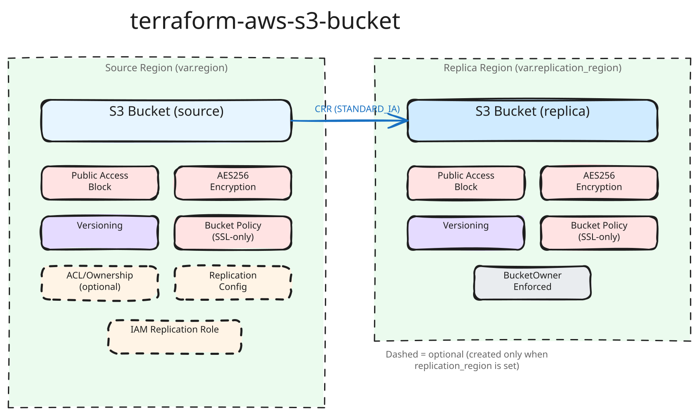

# Architecture

## Overview

The module creates an S3 bucket with security best practices enforced at
the infrastructure level. Optionally, it creates a cross-region replica
for disaster recovery.

## Source Bucket Resources

Every invocation creates:

| Resource | Purpose |
|----------|---------|
| `aws_s3_bucket.this` | The primary S3 bucket |
| `aws_s3_bucket_public_access_block` | Blocks all public access |
| `aws_s3_bucket_server_side_encryption_configuration` | AES256 at rest by default; SSE-KMS with a CMK when `kms_key_arn` is set |
| `aws_s3_bucket_policy` | SSL-only access + user policy. Denies KMS uploads by default; with `kms_key_arn` set, instead enforces uploads onto that CMK |

Conditionally created:

| Resource | Condition |
|----------|-----------|
| `aws_s3_bucket_versioning` | `enable_versioning = true` |
| `aws_s3_bucket_ownership_controls` | `enable_acl = true` |
| `aws_s3_bucket_acl` | `enable_acl = true` |

## Replication Resources

When `replication_region` is set, the module creates:

| Resource | Purpose |
|----------|---------|
| `aws_s3_bucket.replica` | Replica bucket in target region |
| `aws_s3_bucket_public_access_block.replica` | Blocks public access |
| `aws_s3_bucket_server_side_encryption_configuration.replica` | AES256 |
| `aws_s3_bucket_versioning.replica` | Required for CRR |
| `aws_s3_bucket_policy.replica` | SSL-only access |
| `aws_iam_role.replication` | Role for S3 replication service; not created when `replication_role_arn` is set |
| `aws_iam_role_policy.replication` | Permissions for replication; not created when `replication_role_arn` is set |
| `aws_s3_bucket_replication_configuration.this` | Replication rule |

## How Replication Works

1. The module creates a replica bucket using AWS provider v6's
   per-resource `region` argument (no provider aliases needed).
2. An IAM role grants the S3 service permission to read from the source
   and write to the replica. The module creates it, unless you pass your
   own in `replication_role_arn`.
3. A replication configuration on the source bucket replicates all objects
   (whole-bucket filter) to the replica with `STANDARD_IA` storage class.
4. Delete marker replication is enabled for a true mirror.

## Replication Role Lifecycle

Replication must never point at a role that doesn't exist or has no
permissions: S3 doesn't retry the objects that fail to replicate.

- The replication configuration waits for the role's policy, not only for
  the role, so it is never configured before the role can replicate.
- The role and its policy have `create_before_destroy`. When the role is
  replaced, Terraform creates the new role and policy, moves replication to
  them, and only then deletes the old ones. `name_prefix` gives the two roles
  different names.
- Terraform records `create_before_destroy` in the state. When the module's
  role goes away for good, because you set `replication_role_arn`, its delete
  also waits for the replication update. The flag reaches the state with the
  first apply of a version that has it, which shows no changes; that is why
  [switching to your own role](configuration.md#switching-from-the-modules-role-to-your-own)
  takes two applies.
- Terraform forces `create_before_destroy` onto everything the role's policy
  depends on. Through its policy document, that includes the source and
  replica buckets.

## Bucket Policy Composition

The source bucket's policy is composed by merging:

1. The user-provided `bucket_policy` (if any)
2. An SSL-enforcement deny statement

This uses `aws_iam_policy_document` with `source_policy_documents` for
safe policy merging.

The replica bucket gets only the SSL-enforcement policy (no user
customization).
